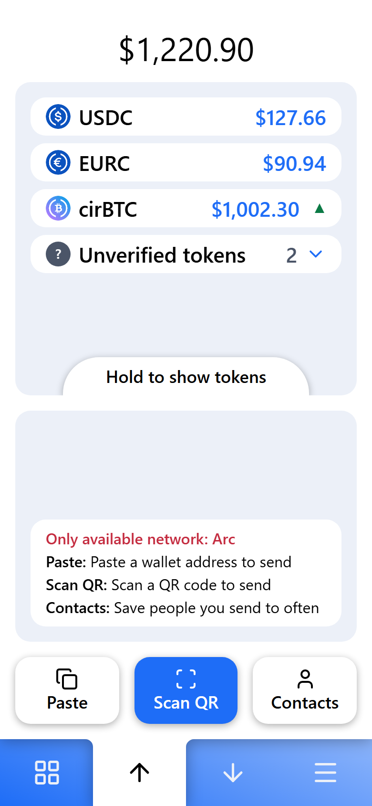
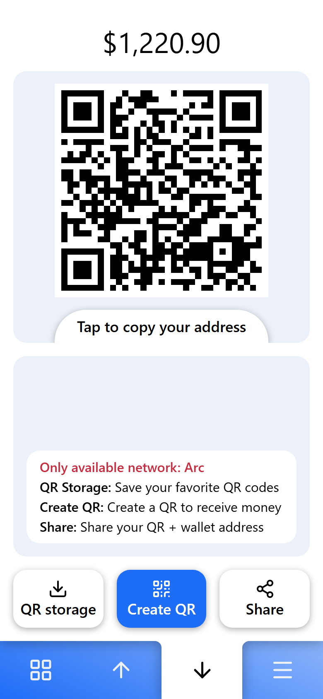
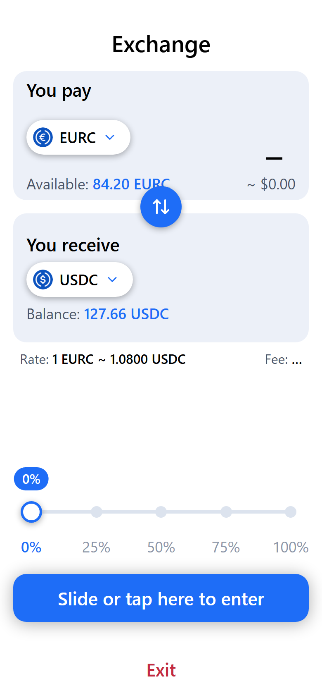
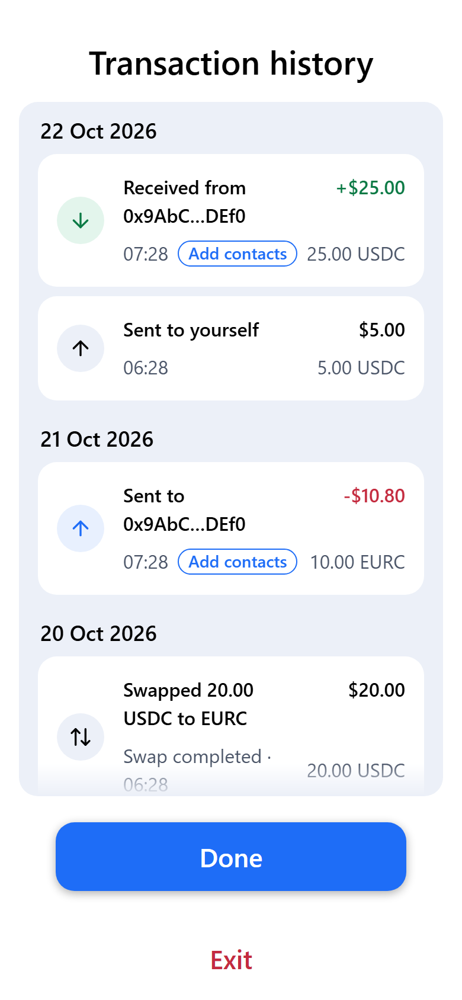

<div align="center">

# ezwallet

**A crypto wallet simple enough for my mom to use.**

[](https://ezwallet.cash)
[](https://explorer.arc.io)
[](https://docs.google.com/presentation/d/1-MuqJeSV1Riwg3Bx6IXZSuNumqbtM83dmzG48-vIRDQ/edit?usp=sharing)
[](./LICENSE)

<table>
<tr>
<td align="center"><br><sub>Balance & send</sub></td>
<td align="center"><br><sub>Receive by QR</sub></td>
<td align="center"><br><sub>Exchange</sub></td>
<td align="center"><br><sub>History</sub></td>
</tr>
</table>

</div>

People shouldn't have to adapt to crypto - crypto should adapt to people. ezwallet keeps full self-custody but
removes the walls: **no seed phrase** (email + 6-digit PIN), **no gas token** (Arc pays fees in USDC), and big
type with one main action per screen.

> ⚠️ Live on **Arc Mainnet** - real money. Start small.

## Features

- **Send** with a note, to an address, a QR or a saved contact. Fee shown up front (Circle's estimate).
- **Auto-convert:** short of USDC? The rest is swapped from EURC / cirBTC in the same transaction - one PIN.
- **Receive** by QR (EIP-681, MetaMask can scan it), with an optional amount; keep QRs in a library.
- **Exchange** USDC ⇄ EURC ⇄ cirBTC, at most 0.5% below the quote (enforced on chain). No app fee.
- **Deposit / withdraw** to any Arc address or exchange. **History** with receipts. **USD or EUR** display.
- **Unverified tokens** are shown apart, never counted in the balance.

**In testing** on [test.ezwallet.cash](https://test.ezwallet.cash) (same mainnet): Service hub with *Lending*
(Morpho vaults) and *Borrow* (USDC against cirBTC, kept at ≤ 50% LTV, email liquidation alerts).

## Stack

| | |
|---|---|
| Wallet | [Circle User-Controlled Wallets](https://developers.circle.com/w3s/programmable-wallets) - MPC keys, PIN signing |
| Chain | [Arc](https://docs.arc.io) mainnet - USDC is the gas token |
| App | React 18 + Vite 5, `viem` |
| Backend | Cloudflare Pages Functions (`functions/api/*`) + KV - the Circle key never reaches the browser |
| Swap / earn / borrow | Circle Stablecoin Kits, one-PIN Multicall3 batch, simulated with `eth_simulateV1` first |
| Prices | CoinGecko, cross-checked with Binance - no price, no number |

## Run locally

```bash
git clone https://github.com/KattyFury/project_arc_ezwallet.git && cd project_arc_ezwallet
npm install
npm run mock    # full UI with a fake wallet - no keys needed
```

For the real API, put `API_KEY` (Circle LIVE), `AUTH_SECRET`, `RESEND_API_KEY` and `COINGECKO_API` in `.env.txt`
(gitignored), bind a KV namespace as `EZ_SYNC`, then run `npm run api` and `npm run dev` in two terminals.
The Circle PIN SDK does not run on `localhost` - test login/PIN on a deployed build. `npm test` runs the unit tests.

## Limits

Not a bank and not independently audited ([SECURITY.md](./SECURITY.md)). Arc only. No private-key export yet.
No card / bank purchases. English only.

## How it was built

End to end with AI (mostly Claude) by someone with no programming background: the product, UX and design
decisions are human; every flow was checked by actually running it.

[MIT](./LICENSE)
